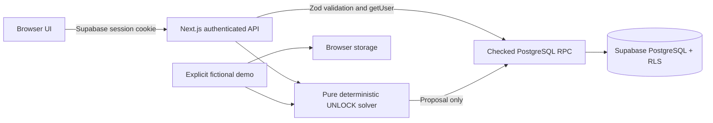

# Architecture

## Boundaries

With no configured Supabase project on a local server, the same authenticated API uses `local-runtime.ts` and `local-accounts.ts`. SQLite stores accounts, hashed credentials/tokens, private preferences and shared community records. Server checks derive identity from an opaque HttpOnly session, project accessible records, and verify ownership, membership and roles before atomic mutations. Local accounts never seed fictional data; the browser demo is separate. Supabase remains the hosted backend with independent RLS/RPC rules. See [account setup](ACCOUNTS.md).

`src/app/[...path]/page.tsx` is a server route dispatcher for the requested product routes. It checks authentication and onboarding before rendering the workspace. Public landing/auth pages remain available. APIs authenticate again: page guards never substitute for mutation authorization. `src/proxy.ts` refreshes Supabase cookies; `getUser()` verifies the server-side identity.

The client store provides the same UI operations in two explicitly separate modes. Live mode reads `/api/state` and posts validated operations to `/api/mutate`. Demo mode runs the solver and isolated local state transitions against fictional fixtures. The demo cookie only chooses this interface and never grants live API access. Full reloads at identity changes clear the prior identity's route and React caches.

Client account reads share an in-flight promise. A version counter invalidates earlier reads when a mutation begins; the successful mutation forces a new canonical read. This prevents a delayed pre-save response from replacing newer state. Visible pages refresh every 30 seconds and on focus/visibility return, while social pages keep their five-second polling. Failed initial reads show retry/sign-in recovery; later failures preserve the last loaded state with an explicit stale-data banner. A current 401 clears the private client workspace. This is request ordering and recovery within the browser, not optimistic concurrency control for competing server writes.

Place filters/selection, school searches and connection tabs/conversations use `use-url-state.ts`, a subscribed native History API wrapper integrated with the Next router. Typing replaces the current history entry; choosing a place or conversation pushes an entry for Back/Forward navigation. Search only projects readable activities/communities and eligible accepted connections from the server-scoped workspace, alongside the static public venue catalogue. Youth connection results route to a valid approved shared community chat.

`chat-drafts.ts` stores unsent composer text in versioned tab-session entries, scoped by actor, demo/account mode and hub/connection. Each entry is bounded to 1,500 characters and expires 24 hours after its last edit. Canonical reads prune inaccessible conversations; identity transitions and detected expiry clear the app's draft entries. Server-rendered HTML never includes these browser drafts. The inbox preview helper accepts only eligible accepted parties, excludes unrelated authors and substitutes removed-message placeholders. The server remains authoritative for chat membership and sending permissions.

Supabase clients use only the public key plus the caller's authenticated session. There is no service-role key. Private tables have RLS. Application tables grant authenticated clients SELECT under RLS; checked, transactional RPCs perform mutations and independently verify `auth.uid()`, ownership, membership and roles. The `public` schema disallows client object creation, function search paths are pinned, and anonymous function execution is revoked.

## Data model

| Table                      | Purpose and access                                                                                                                                  |
| -------------------------- | --------------------------------------------------------------------------------------------------------------------------------------------------- |
| `profiles`                 | Own display name, broad city, one-time age category, interests, opt-in and general preferences. Other profile rows are not a public directory.      |
| `platform_admins`          | Explicit project-admin bootstrap; cannot be self-assigned.                                                                                          |
| `hubs`                     | Public adult or private organization community; platform-controlled approval and youth approval.                                                    |
| `hub_members`              | Unique hub/user relationship, pending/approved/rejected membership, hub_admin/organizer/member role, peer-tutor approval.                           |
| `hub_invitations`          | Random code SHA-256 hash, creator, single use, expiry and redeemer.                                                                                 |
| `sparks`                   | Organizer-owned activity, visibility scope, category, size, city, budget and lifecycle.                                                             |
| `spark_requirements`       | Normalized quantities, kinds, skills and required room/venue capacity.                                                                              |
| `availability_slots`       | Real timestamp intervals attached to one Spark or one offer.                                                                                        |
| `resource_offers`          | Owned opted-in participation, tutor, equipment and venue offers; quantity, capacity, costs, expertise and dependencies.                             |
| `match_proposals`          | One current proposal per Spark; computed explanations, selected time and database-revalidated feasibility.                                          |
| `proposal_actions`         | One approval per proposed offer; canonical owner/kind/cost loaded from the database.                                                                |
| `participation_requests`   | Explicit requests, approved by organizer; capacity and eligibility rechecked.                                                                       |
| `sessions`                 | One session per Spark, established after sending invitations.                                                                                       |
| `session_participants`     | Accepted participants and attendance, keyed to the Spark so initial organizers/requesters exist before a session is proposed.                       |
| `resource_reservations`    | Exclusive offer reservations and individual person reservations. GiST exclusions prevent overlapping intervals, including concurrent confirmations. |
| `spark_declines`           | Rejected offers remain excluded from future suggestions for the same activity.                                                                      |
| `reports`                  | Reporter and authorized moderator access.                                                                                                           |
| `user_blocks`              | Private block list; matching access checks work in both directions.                                                                                 |
| `saved_sparks`             | Private saved-activity relationship.                                                                                                                |
| `notifications`            | Private invitations with links to session rooms.                                                                                                    |
| `audit_logs`               | Mutation actor, operation, entity and time; platform-admin read access.                                                                             |
| `venues`                   | Source-backed badminton/study listing with operator booking URL; no copied live availability.                                                       |
| `venue_booking_references` | Organizer-only private reference, separate from shared court/room and booking-status fields on Sparks.                                              |
| `connections`              | Unique reciprocal pair with pending/accepted/declined consent; parties-only access and block checks.                                                |
| `chat_messages`            | Exactly one community or adult connection scope; checked send/remove RPCs and current membership access.                                            |

Foreign keys, unique relationships, value checks and indexes are in the migration. `btree_gist` enables exclusion constraints. PostgreSQL uses half-open intervals `[start,end)`, so adjacent sessions are allowed. Quantities are units, while capacity is how many people a venue/room can accommodate.

## Confirmation transaction

1. Verify organizer, current community access and pending session state.
2. Lock Spark and proposal; verify every action is accepted.
3. Revalidate supplied times, participant count, total cost, skill requirements, combined resource quantities, offer ownership, current opt-in, tutor approval and dependencies.
4. Lock offers in stable ID order; recheck available intervals.
5. Insert resource and person reservations. Exclusion constraints resolve races between simultaneous requests.
6. Add accepted invitees to participants; update the session and Spark to CONFIRMED; pin the activity to its confirmed window.

A failure rolls back the entire operation. Completing does not invent attendance. Cancellation releases reservations. Participant withdrawal blocks the session, releases reservations, records a decline and leaves the confirmed time fixed while a replacement is sought. Re-proposing requires new resource approvals.

## UI organization

The reusable visual components are native SVG/CSS illustrations and network diagrams, with no external image dependency. Native dialogs provide focus management and escape behavior; labels, semantic headings, skip navigation, focus rings, reduced motion and text/state descriptions support accessible use. Recharts is loaded separately from the initial interface. OpenStreetMap is an optional external embed; its failure does not block core activity workflows.

## Scale boundary

The initial read model intentionally favors a reviewable MVP over a distributed system. Before a broad launch, introduce paginated queries, bounded server job execution for larger portfolios, stale-proposal notifications, load tests, rate limiting and monitored moderation operations. The current portfolio search considers at most 20 open activities, 12 supplied windows each, and 32 beam states. There is no durable queue or AI model in UNLOCK.
